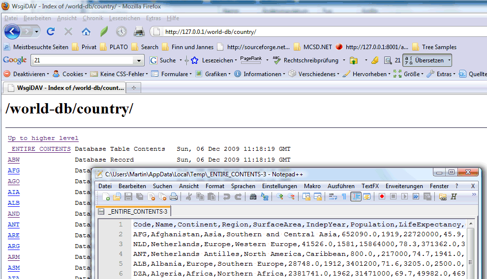
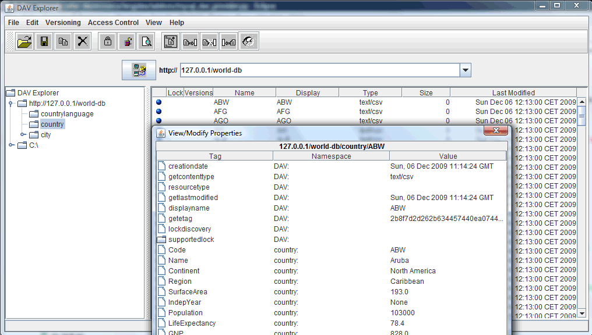

MySQL WebDAV provider
=====================

.. warning::
   This provider is part of ``wsgidav.samples``. Samples are provided as examples
   and as a starting point for custom extensions only.
   They are not covered by the test suite, are only lightly maintained, and
   are **not guaranteed to work correctly or securely**.
   Review and test the code carefully before using it in production.

Examples
--------
This screenshot shows how the *country* table of MySQL's *world-db* sample
database is published as a collection.

All table rows are rendered as non-collections (text files) that contain the
CSV formatted columns.

An additional virtual text file *_ENTIRE_CONTENTS* is created, that contains
th whole CSV formatted table content.

The table's columns are mad accessible as live properties:

Usage
-----
To publish an MySQL database, simply add these lines to the configuration file::

    ### Publish an MySQL 'world' database as share '/world-db'
    from wsgidav.samples.mysql_dav_provider import MySQLBrowserProvider
    addShare("world-db", MySQLBrowserProvider("localhost", "root", "test", "world"))

Module description
------------------
.. automodule::  wsgidav.samples.mysql_dav_provider
