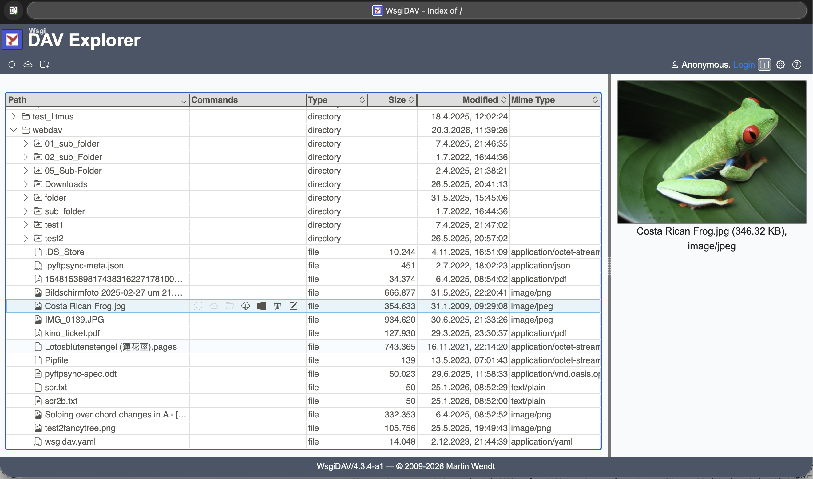

============
DAV Explorer
============

*This section describes how to use the built-in WsgiDAV web interface, DAV Explorer.*

WsgiDAV comes with a slick web interface that allows to explore the DAV share and 
perform basic operations (create, delete, move, copy, rename, ...) directly
in the browser, without the need for additional software or drive mapping. |br|
Up- and downloading of files is supported using drag-and-drop or file dialogs. |br|
Also inline editing of office documents is supported when MS Office or LibreOffice is 
installed on the client machine.

.. note::

  DAV Explorer is available since version 4.4. |br|
  It has beta status and is not enabled by default, but must be explicitly enabled 
  in the configuration file ``wsgidav.yaml``.

.. toctree::
   :maxdepth: 1

Configuration
-------------

TODO: Add configuration instructions here. |br|
See :doc:`user_guide_configure` for more details on how to configure WsgiDAV.

Using DAV Explorer
------------------

TODO: Add detailed instructions here.

Viewing and Editing Text Files
~~~~~~~~~~~~~~~~~~~~~~~~~~~~~~

Text and source files (for example ``.txt``, ``.md``, ``.toml``, ``.yaml``,
``.py``, ``.js``, ``.html``, ``.ps1``) are displayed with syntax highlighting
in the details pane. Files larger than ``dav_explorer.max_preview_size_kb``
are not displayed.

Unless the share or DAV Explorer is readonly, click **Edit** above the text (or
choose *Edit* from the context menu) to change the file:

- The file is locked (WebDAV ``LOCK``), so other users and clients cannot
  modify it while it is being edited. The lock is refreshed while the editor
  is open.
- **Save** (or :kbd:`Ctrl+S` / :kbd:`Cmd+S`) stores the file with a ``PUT``
  request that passes the lock token.
- **Close** (or :kbd:`Esc`) releases the lock (``UNLOCK``). DAV Explorer asks
  before unsaved changes are discarded.

The editor (`CodeMirror <https://codemirror.net>`_) is loaded from a CDN
(esm.sh) when a text file is displayed for the first time. If it cannot be
loaded, the text is displayed without highlighting and cannot be edited.

Known Limitations
-----------------

TODO: Add detailed instructions here.

       Feature          |       macOS        |      Windows       |       Linux
----------------------- | ------------------ | :----------------: | :---------------:
Drag files to desktop   | :white_check_mark: | :white_check_mark: | :white_check_mark:
Drag files from desktop | :white_check_mark: | :white_check_mark: | :white_check_mark:
